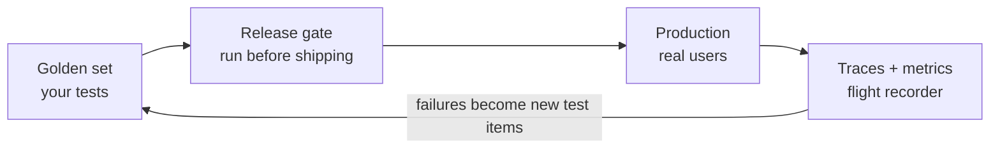

# Raising a Small Mind

### How to build your own LLM from raw data, told as a story, on one 8 GB GPU

> **Who this is for:** someone comfortable with code who is new to machine learning.
> **What it covers:** every question from the original research brief: data sources, procurement, how much data and why, cleaning, preparing data for training, training itself, deployment, evaluation, and custom evals and observability.
> **Where the facts come from:** the research findings in `research-facility/research/build-llm-from-scratch/findings.md`. Source tags like **[S8]** point to `sources.md` in that folder. Runnable scripts are in `artifacts/` there, and we'll rebuild them together in this repo.
> **One honest caveat up front:** the research machine had no GPU, so the memory and time numbers come from formulas, not measurements. Treat them as ±20–30% until we measure on your card.

---

## Contents

- [Part 0: The whole story on one page](#part-0-the-whole-story-on-one-page)
- [Chapter 1: What are we actually building?](#chapter-1-what-are-we-actually-building)
- [Chapter 2: The library (data sources and procurement)](#chapter-2-the-library-data-sources-and-procurement)
- [Chapter 3: How much reading is enough?](#chapter-3-how-much-reading-is-enough)
- [Chapter 4: Panning for gold (cleaning the data)](#chapter-4-panning-for-gold-cleaning-the-data)
- [Chapter 5: Cutting the bricks (making data training-ready)](#chapter-5-cutting-the-bricks-making-data-training-ready)
- [Chapter 6: School (training)](#chapter-6-school-training)
- [Chapter 7: Manners (turning autocomplete into an assistant)](#chapter-7-manners-turning-autocomplete-into-an-assistant)
- [Chapter 8: Moving out (deployment)](#chapter-8-moving-out-deployment)
- [Chapter 9: The report card (evaluating the LLM)](#chapter-9-the-report-card-evaluating-the-llm)
- [Chapter 10: The driving test and the flight recorder (custom evals and observability)](#chapter-10-the-driving-test-and-the-flight-recorder-custom-evals-and-observability)
- [Chapter 11: Our first week, day by day](#chapter-11-our-first-week-day-by-day)
- [Chapter 12: Ideas for later](#chapter-12-ideas-for-later)
- [Appendix A: Your questions, answered (index)](#appendix-a-your-questions-answered-index)
- [Appendix B: Checklist](#appendix-b-checklist)
- [Appendix C: Pocket glossary](#appendix-c-pocket-glossary)

---

## Part 0: The whole story on one page

Picture an apprentice locked in a huge library. The apprentice has never seen a word before. Their only job is a game:

> *Read a sentence. Cover the next word with your hand. Guess it. Lift your hand. See how wrong you were. Adjust your instincts a tiny bit. Repeat.*

Play that game a few billion times and something odd happens. To guess well, the apprentice has to pick up grammar ("after *the* comes a noun, usually"), facts ("the capital of France is…"), and some reasoning ("2 + 2 = …"). Nobody teaches those things directly. They fall out of getting good at guessing the next word.

**That is all an LLM is: a next-word guesser that got good enough that it looks like understanding.** GPT-4, Llama and the one we're about to build all play the same game. They differ only in size and in how much they've read.

Building one is a journey through nine stations:

```mermaid
flowchart LR
    A[1. Find books<br/>data sources] --> B[2. Throw out junk<br/>cleaning]
    B --> C[3. Cut text into bricks<br/>tokenizer + shards]
    C --> D[4. School<br/>pretraining]
    D --> E[5. Manners<br/>post-training / SFT]
    E --> F[6. Move out<br/>export + serve]
    F --> G[7. Report card<br/>benchmarks]
    G --> H[8. Driving test<br/>custom evals]
    H --> I[9. Flight recorder<br/>observability]
    I -. failures become new tests .-> H
```



In one sentence each:

1. **Find books.** Download text that other people have already scraped and cleaned from the internet (FineWeb-Edu), and learn the cleaning craft on a small raw sample.
2. **Throw out junk.** Most of the internet is menus, spam, duplicates and cookie banners. You keep the educational prose, which is under 1% of what you started with.
3. **Cut text into bricks.** Computers can't read letters, so text becomes integers ("tokens"), stored in big flat files.
4. **School (pretraining).** The guessing game, run billions of times on the GPU. Out comes a *base model*: a fluent autocomplete with no manners.
5. **Manners (post-training).** Show it a few thousand example conversations so it learns to answer instead of rambling. Now it's a *chat model*.
6. **Move out.** Freeze it, shrink it, and put it behind an API.
7. **Report card.** Standard tests that tell you how it compares with other models.
8. **Driving test.** *Your own* tests for what *you* care about, re-run after every change.
9. **Flight recorder.** Log everything it does in use, and turn its failures into new driving-test questions.

### What we can realistically build on your 8 GB card

| | Plan |
|---|---|
| Model size | **110 million parameters** (GPT-2-small class). A 30M "smoke test" model first. |
| Reading | **2.5 billion tokens** (≈ 10 GB of text) of FineWeb-Edu |
| Training time | **≈ 1–2 days** of the GPU running non-stop |
| Cost | **≈ $2–5 of electricity** |
| What comes out | Fluent, grammatical English with shallow knowledge. After SFT it can follow simple instructions. It will *not* be ChatGPT. |
| What you really get | A full understanding of the pipeline, and code that scales: the same recipe on rented 8×H100s for $50–300 gives a GPT-2-level chat model [S1]. |

> **Note about your card.** A *Quadro RTX 4000* (8 GB) is a Turing-generation card. It can't do `bf16`, the number format most modern guides assume. We'll use `fp16` with a "loss scaler" instead (explained in Chapter 6). The training script detects this automatically. If your card is an RTX 4060-class (Ada) instead, `bf16` works. Run `nvidia-smi` and we'll know.

That's the whole map. Each chapter below zooms into one station.

---

## Chapter 1: What are we actually building?

Before touching data, let's open up the apprentice's head. There are four pieces.

### 1.1 The tokenizer: text becomes Lego bricks

A neural network only does arithmetic, so text has to become numbers. We don't use one number per *letter* (sequences get too long) or one per *word* (there are too many words, and new ones keep appearing). We use something in between: **tokens**, which are common chunks of text.

```
"Unbelievably, it worked."  →  ["Un", "believ", "ably", ",", " it", " worked", "."]
                            →  [ 1844,  29813,   1757,   11,   340,    3111,    13 ]
```

- A vocabulary of **32,768** tokens is our Lego set.
- One token is roughly **4 characters**, or ¾ of an English word.
- Common words are a single brick. Rare words get built from several.

### 1.2 The model: 110 million tuning knobs

The model is a huge mathematical function with **parameters**: plain numbers, like the knobs on a mixing desk. Ours has about 110 million of them. When training starts they're random, so the model outputs gibberish. Training is the process of finding good settings for all those knobs.

What does the function actually do with a sentence? It's a stack of 12 identical **blocks**. Inside each block, two things happen:

- **Attention: the meeting.** Every token gets to look back at all the tokens before it and pull in what matters. In *"The animal didn't cross the street because **it** was tired,"* the token "it" learns to attend heavily to "animal." Mechanically, each token broadcasts a *question* (query), every earlier token holds up a *name tag* (key), and where question and name tag match, the earlier token passes over its *notes* (value).
- **MLP: back at the desk.** Each token then works privately on what it just gathered. This is where much of the "knowledge" seems to be stored.

After 12 rounds of meeting-then-desk, the last layer gives **a score for every one of the 32,768 bricks**: "how likely is each to come next?" Those raw scores are called **logits**. A function called *softmax* turns them into probabilities that add up to 100%.

### 1.3 The loss: measuring surprise

After each guess we score how *surprised* the model was by the real next token:

```
loss = −log(probability the model gave to the correct token)
```

- If the model gave the right answer 100%, loss = 0 (no surprise).
- If it gave it 1%, loss ≈ 4.6 (very surprised).
- A brand-new random model spreads its bets evenly over 32,768 tokens, so its loss is ln(32768) ≈ **10.4**. Remember this number: if your loss gets *stuck* at 10.4, you have a bug.
- A decent small model reaches **≈ 3**.

**Perplexity** = e^loss. It means roughly "how many tokens the model is torn between." Loss 3 gives perplexity ≈ 20, as if the model narrowed 32,768 options down to about 20 plausible ones. That's progress you can feel.

### 1.4 Training: walking downhill blindfolded

Imagine standing on a hillside in fog. Height is the loss. You can't see the valley, but you can feel the slope under your feet. So you take a small step downhill, feel again, and step again.

- The **gradient** is the slope. Calculus (*backpropagation*) tells us, for *each* of the 110M knobs, which way to turn it to lower the loss.
- The **learning rate** is the size of your step. Too big and you overshoot and fall off a cliff (the loss *spikes*). Too small and you'll still be on the hill next year.
- The **optimizer** (AdamW) is a smart walker. It keeps momentum, like a ball rolling, and gives every knob its own step size.

One full cycle (show a batch of text → compute loss → compute gradients → nudge the knobs) is a **step**. We'll do about 9,500 of them.

### 1.5 The one equation worth memorising

The total work to train a model is:

```
Compute (FLOPs) ≈ 6 × N × D
    N = number of parameters
    D = number of training tokens
    6 = 2 (forward pass) + 4 (backward pass) multiply-adds per parameter per token
```

Our run: 6 × 110M × 2.5B = **1.65 × 10¹⁸ operations**. Your card realistically does 10–20 trillion per second, so that's **23–46 hours**. This formula answers "how big, how long, how much" for every model ever trained, from ours to GPT-4.

---

## Chapter 2: The library (data sources and procurement)

> *Your questions: "What would be the data sources? How would I first of all procure data?"*

### 2.1 The big idea: don't crawl the web yourself

The raw internet is archived by a non-profit called **Common Crawl**, which publishes petabytes of web pages every month for free [S6]. Almost every open LLM starts there. Raw Common Crawl is like an attic stuffed with the whole internet: mostly junk, with a little treasure.

Teams at Hugging Face, Ai2 and others have already spent huge compute sorting that attic. So the practical path is:

1. **Train on a pre-cleaned dataset** (FineWeb-Edu).
2. **Learn the cleaning craft** by running the same pipeline yourself on one or two raw Common Crawl files (Chapter 4). You'll understand it fully without having to clean petabytes.

### 2.2 The shelves

| Shelf | What it is | Size | License | Good for |
|---|---|---|---|---|
| **FineWeb-Edu** [S8] ⭐ | Common Crawl, filtered by an AI that scored each page's "educational value" | 1.3T tokens (subsets of 10B/100B/350B) | ODC-By (open) | **Our main diet** |
| FineWeb [S7] | Cleaned Common Crawl without the education filter | 15T+ tokens | ODC-By | Comparisons, more variety |
| FineWeb2 [S9] | Same idea for 1000+ languages | ≈ 3T words | ODC-By | Non-English models |
| DCLM-Baseline [S10] | The top 10% of the web according to a quality classifier | 3.8T tokens | CC-BY-4.0 | Alternative high-quality web |
| Dolma 3 [S12] | Ai2's fully open mix: web, PDFs, code, math | ≈ 9T tokens | ODC-By | Seeing a pro "recipe" |
| Wikipedia [S41] | Encyclopedia | ≈ 4–5B tokens (English) | CC BY-SA | Facts |
| The Stack v2 [S17] | Source code | Terabytes | Permissive, requires agreement | Coding ability |
| FineMath, Cosmopedia [S13] | Math pages; AI-written textbooks | 10s–100s of B tokens | Open | Math/reasoning |
| TinyStories [S39] | Simple children's stories written by GPT | ≈ 470M tokens | CDLA | Laptop experiments |
| Raw Common Crawl [S6] | Raw HTML (WARC files, ≈ 1 GB / 30–40k pages each) | Petabytes | CC terms of use | Learning to clean |

### 2.3 How to actually get it

The 10-billion-token sample of FineWeb-Edu (≈ 28 GB) is plenty for us:

```bash
huggingface-cli download HuggingFaceFW/fineweb-edu --repo-type dataset \
  --include "sample/10BT/*" --local-dir fineweb-edu-10BT
```

Or stream it without downloading everything:

```python
from datasets import load_dataset
ds = load_dataset("HuggingFaceFW/fineweb-edu", name="sample-10BT", split="train", streaming=True)
for doc in ds.take(3):
    print(doc["text"][:200], "…")
```

To grab one raw Common Crawl file for the cleaning lab:

```bash
curl -s https://data.commoncrawl.org/crawl-data/CC-MAIN-2025-26/warc.paths.gz | gunzip | head -2
wget https://data.commoncrawl.org/<one of those paths>
```

### 2.4 Librarian's rules

- **Pin versions.** Datasets get updated, so record the exact revision (commit hash). Otherwise you can't reproduce a run.
- **Keep a manifest:** source, date, revision, license, token count. One line per dataset.
- **Avoid pirated books** such as Books3. It's real legal risk, and the open datasets are good enough.
- **If you ever crawl yourself,** respect `robots.txt` and AI opt-outs.

---

## Chapter 3: How much reading is enough?

> *Your questions: "How much data would I need? What's the actual observation behind that?"*

This is one of the best stories in modern AI, because the answer changed twice.

### 3.1 Act one: "Bigger is better" (Kaplan, 2020)

OpenAI researchers trained hundreds of models and found something surprisingly tidy [S18]. Plot loss against model size, data size or compute on log scales and you get **straight lines**. Loss falls predictably as a *power law*. That means you can train small models cheaply, draw the line, and **forecast** how a model 100× bigger will do before spending the money. Everyone took the lesson to be *"make the model bigger."* GPT-3 (175B parameters) was trained on only about 300B tokens.

### 3.2 Act two: "You've been starving your models" (Chinchilla, 2022)

DeepMind asked a sharper question [S19]. *For a fixed compute budget, how should you split it between a bigger model and more data?* They trained more than 400 models and found that **parameters and tokens should grow together, at about 20 tokens per parameter.**

They proved it with a head-to-head:

| | Gopher | Chinchilla |
|---|---|---|
| Parameters | 280B | 70B (4× smaller) |
| Tokens | 300B | 1.4T (4.7× more) |
| Compute | same | same |
| Result | – | **Better on nearly every benchmark** |

A model a quarter the size beat the giant because it had *read enough*. Big models of that era were under-fed.

**Pocket formulas:**

```
N_opt ≈ sqrt(C / 120)      D_opt ≈ 20 × N_opt
```

Feed in our compute budget (1.65 × 10¹⁸ FLOPs, about what your card does in 1–2 days): N ≈ **117M parameters**, D ≈ **2.3B tokens**. That's exactly where our 110M / 2.5B plan comes from. It isn't a guess; it's Chinchilla applied to your GPU.

### 3.3 Act three: "Over-train it anyway" (Llama, SmolLM, 2023–26)

Chinchilla minimises the cost of *training*. But a model gets trained once and *used* millions of times, and a smaller model is cheaper every time it answers. So modern labs deliberately train small models far past 20 tokens per parameter [S20, S45]:

| Model | Tokens per parameter |
|---|---|
| Chinchilla optimum | ≈ 20 |
| Llama 3 8B (15T tokens) | ≈ 1,875, and the authors said it was *"still improving log-linearly"* |
| SmolLM2-1.7B (11T tokens) [S13] | ≈ 6,500 |

**What that means for us:** 2.5B tokens (≈ 23 tokens per parameter) is the "fair" minimum. Pushing to 10B tokens (≈ 90 per parameter) keeps making the model better, at the cost of 4× the GPU time.

### 3.4 Two more observations that matter

- **Re-reading is nearly free, up to a point [S21].** If you run out of fresh data, repeating it up to **≈ 4 times (epochs)** is almost as good as new data. After about 16 repeats, extra passes add almost nothing.
- **Quality beats quantity at small scale [S7, S8].** A model trained on FineWeb-*Edu* reached the same knowledge-test scores (MMLU, ARC) as one trained on plain FineWeb with **about 10× fewer tokens**. A good textbook beats ten tabloids. This single result is why we start from FineWeb-Edu.

### 3.5 Unit conversions to keep handy

```
1B tokens  ≈ 4 GB of raw text  ≈ 2 GB on disk once tokenized (2 bytes per token)
```

---

## Chapter 4: Panning for gold (cleaning the data)

> *Your question: "How would I clean that data?"*

### 4.1 The yield is brutal

Take one raw Common Crawl file:

```
100%  raw HTML (menus, ads, scripts, spam, other languages, duplicates…)
 ~10%  usable English text after extraction and basic filters
~0.8%  after an "educational value" filter keeps the top ~8% of that
```

Cleaning is a series of sieves, each catching a different kind of junk. Here they are in the order FineWeb runs them [S7]. The illustrative examples are mine.

### 4.2 The sieves

**Sieve 1: Extract the actual text.** A web page is 90% scaffolding. **Trafilatura** finds the main article and drops navigation, footers and ads. Common Crawl also ships its own pre-extracted text ("WET files"), but FineWeb's experiments found models trained on it came out *worse*. Extraction quality really matters [S7].

**Sieve 2: URL blocklist.** Drop known adult, malware and spam domains.

**Sieve 3: Language ID.** A tiny fastText model guesses each page's language. Keep English with confidence ≥ 0.65 [S42].

**Sieve 4: Repetition (Gopher rules) [S44].** Spam repeats itself. Drop a page if:
- more than 30% of its lines are duplicates, or
- its single most common 2-word / 3-word / 4-word phrase covers more than 20 / 18 / 16% of the text.

**Sieve 5: Does this look like human prose? (Gopher quality rules).** Keep a page only if:
- it has between 50 and 100,000 words;
- the average word is 3–10 letters long (filters out gibberish and URL soup);
- there's at most 1 symbol (`#`, `…`) per 10 words;
- at most 90% of lines are bullets and at most 30% end in "…";
- at least 80% of words contain letters;
- it contains **at least 2 common words** like *the, and, of, to*. Real English sentences always do; keyword spam often doesn't.

**Sieve 6: Line-level tidying (C4 rules).** Keep lines that end in punctuation and have at least 3 words. Remove "lorem ipsum", stray `{`, "please enable JavaScript" and cookie banners.

**Sieve 7: FineWeb's own extras.** Drop a page if fewer than 12% of lines end in punctuation, more than 10% of characters sit in repeated lines, or more than 67% of lines are under 30 characters (that's a menu, not an article).

A quick worked example:

```
Page A:  "Home | About | Contact" ×20  +  "BUY NOW!!! BEST PRICE"
         → no "the/and/of", heavy repetition → DROPPED (sieves 4 & 5)

Page B:  "Mitochondria are organelles that produce most of the cell's
          energy. They contain their own DNA, which suggests…"
         → passes every rule → KEPT
```

You can run exactly this with `python artifacts/quality_filters.py`.

**Sieve 8: Near-duplicates (MinHash).** The same article appears on hundreds of sites with small changes: a different footer, a typo fixed. Comparing every page with every other page is impossible at billions of pages, so we use a trick based on fingerprints:

1. Chop each page into overlapping 5-word phrases ("shingles").
2. Run 112 different hash functions over the shingles and keep only the **smallest** hash from each. That's the page's 112-number *fingerprint*.
3. The neat bit of maths: *the chance that two pages share a minimum hash equals how much their shingle sets overlap* (their "Jaccard similarity").
4. Split the fingerprint into 14 bands of 8 numbers. Two pages become duplicate candidates if *any* band matches exactly.

That banding produces a sharp cut-off:

| How similar two pages are | Chance they get flagged |
|---|---|
| 50% overlap | 5% |
| 70% overlap | 57% |
| 80% overlap | 92% |

So near-copies get caught and merely related pages don't. Try it with `python artifacts/minhash_dedup.py`.

> **A plot twist worth remembering.** FineWeb tried deduplicating *across all crawls at once*, and the model got **worse**. Pages that survived years of re-crawling were mostly the *good* pages (people keep them online), so global dedup threw out the best content. The fix was to dedup **within each monthly crawl** only [S7]. Cleaning rules have to be tested, not assumed.

**Sieve 9: Hire a teacher (model-based quality filter).** This is the biggest win of all. FineWeb-Edu's recipe [S8]:

1. Have a big, smart model (Llama-3-70B) read **460,000** pages and grade each 0–5 for "how useful is this for teaching a student?"
2. Train a small, *cheap* model to imitate those grades.
3. Run the cheap grader on billions of pages and keep only scores ≥ 3. That **drops about 92%** of pages.

It's like hiring an expensive professor to grade a sample, then training a teaching assistant to grade the rest. DCLM uses the same idea with an even simpler classifier [S10]. **Your DIY version:** have any LLM grade 5–20k pages against a rubric, then train a fastText classifier on those grades.

**Sieve 10: Privacy.** Replace email addresses and IP addresses with placeholders. Optionally run a toxicity classifier, as Dolma does.

**Sieve 11: Don't let the student see the exam (decontamination).** If benchmark questions leak into your training data, test scores become meaningless: the model memorised the answers. Drop any training document that shares a 13-word sequence (GPT-3's rule [S49]) with a test set: MMLU, HellaSwag, GSM8K and **your own golden set** (Chapter 10). Do the same for chat data later.

### 4.3 The real tool: datatrove

Hugging Face's **datatrove** [S40] is the exact library FineWeb was built with. Here's the whole pipeline in one block:

```python
from datatrove.executor import LocalPipelineExecutor
from datatrove.pipeline.readers import WarcReader
from datatrove.pipeline.extractors import Trafilatura
from datatrove.pipeline.filters import (URLFilter, LanguageFilter, GopherRepetitionFilter,
    GopherQualityFilter, C4QualityFilter, FineWebQualityFilter)
from datatrove.pipeline.formatters import PIIFormatter
from datatrove.pipeline.writers.jsonl import JsonlWriter

LocalPipelineExecutor(pipeline=[
    WarcReader("s3://commoncrawl/crawl-data/CC-MAIN-2025-26/segments/", glob_pattern="*/warc/*", limit=2),
    URLFilter(), Trafilatura(favour_precision=True), LanguageFilter(),
    GopherRepetitionFilter(), GopherQualityFilter(), C4QualityFilter(filter_no_terminal_punct=False),
    FineWebQualityFilter(), PIIFormatter(), JsonlWriter("out/filtered")],
  tasks=8, workers=8, logging_dir="logs/filter").run()
# then MinHash dedup: MinhashDedupSignature → Buckets → Cluster → Filter
```

(Argument names drift between versions, so check datatrove's `examples/fineweb.py` when we run it.) The most useful thing we can do in the lab is **look at what each sieve threw away.** That's where the intuition comes from.

---

## Chapter 5: Cutting the bricks (making data training-ready)

> *Your question: "How to make the data available for training?"*

Clean text still isn't food for a GPU. Three things need to happen: build the Lego set (tokenizer), convert the whole library into brick numbers (sharding), and load it efficiently (packing and data loading).

### 5.1 Building the Lego set: Byte-Pair Encoding (BPE)

We don't hand-pick the 32,768 bricks; we *learn* them from the data. The algorithm is simple enough to do on paper:

1. Start with the 256 possible bytes as bricks. Every text can be spelled with them.
2. Count every adjacent pair of bricks in the corpus.
3. Merge the most frequent pair into a new brick.
4. Repeat until you have 32,768 bricks.

A toy corpus: *"hug"* ×10, *"pug"* ×5, *"hugs"* ×5.

```
Start:     h u g (×10)   p u g (×5)   h u g s (×5)
Pair counts: u+g = 20,  h+u = 15,  p+u = 5,  g+s = 5
Merge #1 "u"+"g" → "ug":   h ug   p ug   h ug s
Merge #2 "h"+"ug" → "hug": hug    p ug   hug s
Merge #3 "hug"+"s" → "hugs" …
```

Frequent words become single bricks; rare words stay spelled in pieces. A few details matter:

- **32,768 bricks** suits small models (nanochat uses the same, 2¹⁵ [S1]). A bigger vocabulary means fewer tokens per sentence, but the first and last layers of the model grow, and on 8 GB that hurts (Chapter 6).
- Numbers get split into chunks of at most 3 digits, so the model sees `1234567` as `123|456|7` and can learn arithmetic patterns.
- **Reserve special tokens now:** `<|endoftext|>`, `<|user_start|>`, `<|assistant_start|>` and friends. They're the punctuation of conversations, and adding them later is painful.
- **Sanity check:** on held-out English, aim for about **4.2–4.8 characters per token.** Less than that means the tokenizer is wasting bricks.

```bash
python artifacts/train_tokenizer.py --vocab 32768 --docs 500000 --out tok32k.json   # ~20–40 min on CPU
```

### 5.2 Sharding: the library as giant number files

Tokenize everything **once** and save it as flat arrays of `uint16` (2-byte integers). That works because 32,768 < 65,536. Each shard holds about 100M tokens (≈ 200 MB). **Shard 0 is set aside as validation data**: pages the model never trains on, so we can check it's learning rather than memorising.

```bash
python artifacts/prepare_data.py --tok tok32k.json --tokens 2.6e9 --outdir data/   # a few hours, ~5 GB
```

### 5.3 Packing: a train with no empty seats

The model reads in fixed windows of **1,024 tokens**. Documents come in all lengths. Rather than padding short documents with blanks (wasted compute), we **glue all documents end to end** with an `<|endoftext|>` brick between them and cut the stream into 1,024-token carriages. Every seat on the train is filled.

### 5.4 Data loading

The loader memory-maps the shard files (`np.memmap`), picks random windows, and copies them to the GPU in the background. At our scale the CPU never becomes the bottleneck.

### 5.5 Diet planning (data mixtures)

Bigger projects blend sources by percentage, for example 70% web / 15% code / 10% math / 5% Wikipedia. One trick is worth stealing even on a single GPU: **save your best data for the final 10–20% of training,** while the learning rate is winding down. That's when the model locks in what it's learned, so put the dessert last [S13, S14].

---

## Chapter 6: School (training)

> *Your questions: "How would I understand how to train? How would I actually train, and what's the actual process like?"*

This is the longest chapter because it's where the science lives. We'll go from the design of the brain, to the memory budget, to the clock, to the settings, to watching it learn.

### 6.1 The brain's design (a settled recipe)

In 2025–26 almost every open model (Llama, Qwen3, OLMo 2, SmolLM) uses the same blueprint. Here's what each fancy name means in plain English:

| Component | What it does | Analogy |
|---|---|---|
| **Decoder-only transformer** | The stack of attention + MLP blocks from Chapter 1 | The apprentice's brain |
| **RMSNorm** (pre-norm) | Rescales numbers before each sub-step so they don't blow up or vanish | Turning the volume to a sensible level before each speaker |
| **RoPE** | Encodes word *position* by rotating vectors | Every word gets a clock-hand angle; the gap between angles says how far apart words are |
| **SwiGLU** | A gated MLP | A desk with a valve on what gets through |
| **QK-norm** | Normalizes attention queries and keys | Stops the meeting from turning into shouting (training spikes) [S11] |
| **Tied embeddings** | The same table turns tokens into vectors at the start and vectors back into tokens at the end | One dictionary used in both directions; saves 25M parameters |

Our shapes:

| Model | Layers | Width (d) | Heads | Parameters |
|---|---|---|---|---|
| Smoke test | 6 | 384 | 6 | ≈ 30M |
| **Main run** | **12** | **768** | **12** | **≈ 110M** |
| Stretch goal | 24 | 1024 | 16 | ≈ 336M |

Rule of thumb: parameters ≈ 12 × layers × d² + vocab × d. For us that's 12 × 12 × 768² + 32,768 × 768 ≈ 85M + 25M = **110M**.

We build it so its layout matches Qwen3 exactly. That one decision means every standard tool (Hugging Face, TRL, llama.cpp, vLLM, lm-eval) can load our model without changes. The research verified this conversion is lossless.

### 6.2 Packing the suitcase: why 8 GB caps you where it does

Training memory is a suitcase. Here's what has to fit:

```
VRAM ≈ weights + gradients + optimizer memory + activations + logits + ~0.8 GB overhead
```

**Weights, gradients, optimizer.** With standard AdamW each parameter costs **16 bytes**: 4 for the weight, 4 for its gradient, and 8 for Adam's two running averages (momentum and step-size memory), plus some bookkeeping. **8-bit Adam** [S22] compresses Adam's memory and gets this to about **10 bytes**. 110M × 16 B ≈ 1.6 GB, which is fine.

**Activations.** During the forward pass the model has to *remember its intermediate work* so the backward pass can compute gradients. That costs roughly 34 × sequence × batch × width bytes per layer. **Activation checkpointing** is the escape hatch: store only each block's input and *recompute* the rest when needed. You trade ≈ 33% more compute for most of that memory back.

**Logits: the hidden memory hog.** This surprises everyone. For every position in the batch, the model outputs a score for *all 32,768 tokens*. For a micro-batch of 8 × 1,024 positions:

```
8 × 1024 × 32768 × ~10 bytes ≈ 2.5 GB
```

That's **more than the model, its gradients and its optimizer combined.** The fix is **chunked loss**: compute the scores a slice at a time and throw each slice away (`--loss_chunks 4`). It's also why we chose a 32k vocabulary rather than 128k.

The research's memory calculator puts it together:

| Setup | Params | Total | Fits 8 GB? |
|---|---|---|---|
| 110M, micro-batch 8, AdamW | 110M | 7.3 GB → **≈ 5.5 GB with chunked loss** | ✅ |
| 336M, micro-batch 4, AdamW | 336M | 10.2 GB | ❌ |
| 336M + 8-bit Adam + checkpointing | 336M | 5.5 GB | ✅ |

Only about 7.0–7.4 GB is really usable once the driver and desktop take their share, so running headless helps.

**The punchline:** memory would let you train about 350M parameters, but **time** is the real wall. 350M takes 1–3 weeks on your card; 110M takes 1–2 days. So 110M it is.

### 6.3 The clock

Using 6 × N × D, with about 10–20 trillion operations per second actually achieved on a consumer 8 GB card. (Peak numbers on the box are higher, but real code reaches about 25–40% of them; that fraction is called **MFU**.)

| Model | Tokens | Compute | at 10 TFLOPS | at 20 TFLOPS |
|---|---|---|---|---|
| 30M (smoke test) | 0.6B | 1.1 × 10¹⁷ | 3 h | 1.5 h |
| **110M (main)** | **2.5B** | 1.65 × 10¹⁸ | **46 h** | **23 h** |
| 110M (extended) | 10B | 6.6 × 10¹⁸ | 7.6 days | 3.8 days |
| 336M | 7B | 1.4 × 10¹⁹ | 16 days | 8 days |

Electricity is ≈ 300 W × 30–46 h ≈ 9–14 kWh, or **a few dollars.** For comparison, one rented H100 would do the main run in 3–5 hours for $10–15.

### 6.4 The settings, and why each one

**Batch size: how many tokens before each knob-turn.** We want about **262,000 tokens per step** so each step's slope estimate is reliable. Only 8 sequences fit in memory at once, so we use **gradient accumulation**: run 8 sequences, *add up* their gradients without stepping, repeat 32 times, *then* step. 8 × 1,024 × 32 = 262k. It's mathematically the same as one giant batch, just slower, and it's the number-one trick on small GPUs. That works out to ≈ 9,500 steps for 2.5B tokens.

> **Out of memory? Try these in order:** halve the micro-batch and double accumulation → more loss chunks → activation checkpointing → 8-bit Adam → sequence length 512.

**Learning rate: step size.** **6 × 10⁻⁴** for a 110M model (GPT-3's value for this size [S49]); 3 × 10⁻⁴ at 350M. Bigger models want smaller steps.

**Learning-rate schedule: how the step size changes over time.**

```
LR
 ^      ________________________________
 |     /                                \
 |    /                                  \
 |   /                                    \
 |__/______________________________________\___> steps
   warmup        stable (80%)        decay (last 20%)
   (500 steps)
```

- **Warmup:** start with tiny steps. Early on, the random model's gradients are wild, and big steps would wreck it.
- **Stable:** cruise at full speed.
- **Decay:** shrink the steps to settle into the bottom of the valley. This is the "dessert" phase from §5.5.

This shape is called **WSD** (warmup–stable–decay) [S50]. Its big advantage over the classic cosine curve is that you can **extend the run later** by branching from the stable phase, so going from 2.5B to 10B tokens doesn't mean starting over.

**Other settings** (all with good defaults in the script):
- AdamW betas (0.9, 0.95): how much momentum and memory the optimizer keeps.
- Weight decay 0.1, on weight matrices only: a gentle pull toward zero that discourages extreme knob settings.
- **Gradient clipping at 1.0:** if one batch produces a huge slope, cap it. It's a seatbelt.
- Sequence length 1,024: a 110M model gains nothing from longer context.
- `torch.compile`: fuses operations for a 1.3–2× speed-up. The first step takes 1–3 minutes to compile.

**Number precision, and why your card is special.** Training normally stores numbers in fp32 (32 bits). Using 16-bit numbers halves memory and doubles speed. There are two 16-bit formats:

- **bf16** has the same *range* as fp32 with less precision. It's safe and easy, but needs an Ampere or newer card (RTX 30xx/40xx).
- **fp16** has more precision but a tiny range: small gradients round down to zero and big ones overflow to infinity. The fix is a **GradScaler**, which multiplies the loss by a big number before backprop so small gradients stay visible, then divides it back out. It's like zooming in on a faint signal.

**A Quadro RTX 4000 (Turing) needs fp16 + GradScaler.** The script detects your card and picks the right mode.

### 6.5 Watching it learn

What to log and watch:

- **Training and validation loss.** The headline curve. It should fall smoothly from ≈ 10.4 toward ≈ 3.
- **Gradient norm.** Sudden jumps warn of instability.
- **Learning rate, tokens/sec, MFU, peak memory.**
- **Sample generations every few hundred steps.** This is the fun part. You'll literally watch language appear:

```
step 0      "ivals sorted Wuldryn alcoholic ingen..."           (random bricks)
step 500    "the the of and is to the in a of..."               (learned common words)
step 2000   "The cell is a part of the body that is the..."     (grammar appears)
step 9500   "Photosynthesis is the process by which plants
             convert light energy into chemical energy..."      (fluent, topical)
```
*(Illustrative; your exact samples will differ.)*

- **Bits-per-byte (bpb).** Loss re-expressed per byte of raw text. It lets you compare models with *different* tokenizers fairly. Expect ≈ 1.0–1.2 at our size.

**Reference point:** a GPT-2-sized model trained on FineWeb-Edu reaches validation loss ≈ 3.0–3.3 and HellaSwag ≈ 0.30–0.33 after 10B tokens. The original GPT-2 scored 0.294 [S3]. Matching that at home is a real milestone.

### 6.6 Checkpoints and things that go wrong

**Checkpoints:** every ≈ 30 minutes, save model + optimizer + step number. Write to `last.pt.tmp`, then rename it, so a crash mid-save can't corrupt your only copy. If the run dies, just rerun the same command and it resumes.

| What you see | What it probably means | What to do |
|---|---|---|
| Loss suddenly spikes | Learning rate too high, or a weird batch | Lower the LR; rewind to a checkpoint and skip that data |
| Loss becomes NaN / inf | fp16 overflow | Check the GradScaler (Turing) or switch to bf16 |
| Loss stuck at ≈ 10.4 | A bug: targets not shifted, LR = 0, broken data | Inspect a batch by hand |
| Validation loss far *below* training | Validation data leaked into training | Rebuild the split |
| Loss implausibly low | Duplicate data; the model is memorising | Deduplicate |
| Low tokens/sec | No compile, no fused attention, or slow loading | Fix the loader and flags |

Failures are normal even for the giants: Llama 3 405B's run was interrupted **466 times in 54 days** [S20]. Resumable training isn't optional.

### 6.7 How the pros scale up (for context)

The same code becomes multi-GPU with **DDP** (each GPU holds a full copy and they average gradients), then **FSDP/ZeRO** (the model is split across GPUs when it doesn't fit on one), and finally tensor/pipeline parallelism at 10B+ parameters [S52]. Nothing about the science changes, only the plumbing.

---

## Chapter 7: Manners (turning autocomplete into an assistant)

After pretraining you have a **base model**. Ask it *"What is the capital of France?"* and it might continue with *"What is the capital of Germany? What is the capital of…"*. To a base model, your question is just the start of a document, maybe a quiz. It isn't being rude; nobody has taught it the *format* of a conversation.

### 7.1 SFT: learning by example

**Supervised fine-tuning** shows the model thousands of conversations written in a fixed format:

```
<|user_start|>What is the capital of France?<|user_end|>
<|assistant_start|>The capital of France is Paris.<|assistant_end|>
```

It's the same guessing game, with one twist: **we only score its guesses on the assistant's turns.** We want it to learn to *answer*, not to imitate the user.

- Data: `HuggingFaceTB/smol-smoltalk` [S13], 1–3 passes.
- Learning rate ≈ 1 × 10⁻⁴ for tiny models.
- **Time on your card: minutes to a few hours.**

```python
from trl import SFTTrainer, SFTConfig
from datasets import load_dataset
ds = load_dataset("HuggingFaceTB/smol-smoltalk", split="train")
cfg = SFTConfig(output_dir="sft", per_device_train_batch_size=8, gradient_accumulation_steps=8,
                learning_rate=1e-4, num_train_epochs=1, fp16=True,  # bf16=True on Ampere/Ada
                max_length=1024, assistant_only_loss=True, gradient_checkpointing=True)
SFTTrainer(model="hf_model", args=cfg, train_dataset=ds).train()
```

> **The most common silent bug in post-training:** the chat format (**template**) used during training differs from the one used when serving. Nothing crashes; the model just quietly gets dumber. Our export script writes one template, and we use it everywhere.

### 7.2 Preference tuning (optional at our size)

- **DPO** [S25] shows pairs of answers, *chosen* and *rejected*, and nudges the model toward the chosen ones. It's cheap, and fine at 110M.
- **RLHF** (the original ChatGPT method) trains a separate "reward model" to score answers, then uses reinforcement learning against it [S53].
- **RLVR / GRPO** (2025's big thing: DeepSeek-R1, Tulu 3 [S26]) rewards answers that can be *checked*, like math results or passing code.

**Honest note:** below 1B parameters, SFT does most of the work and RL adds little. We'll do SFT, and maybe DPO as a learning exercise.

---

## Chapter 8: Moving out (deployment)

> *Your question: "How would I deploy this?"*

### 8.1 Pack, shrink, serve

```bash
# 1. Convert our checkpoint to standard Hugging Face (Qwen3) format
python export_hf.py --ckpt ckpt/last.pt --tok tok32k.json --out hf_model

# 2. Convert to GGUF, the single-file format llama.cpp and Ollama use
python llama.cpp/convert_hf_to_gguf.py hf_model --outtype bf16 --outfile m-bf16.gguf

# 3. Quantize (shrink the numbers), 8-bit for a small model
./llama-quantize m-bf16.gguf m-Q8_0.gguf Q8_0

# 4. Serve it with an OpenAI-compatible API
./llama-server -m m-Q8_0.gguf -c 1024 -ngl 99 --port 8080
curl localhost:8080/v1/chat/completions -d '{"messages":[{"role":"user","content":"Hi!"}]}'
```

Alternatives: **Ollama** (`FROM ./m-Q8_0.gguf` in a Modelfile, then `ollama create mymodel -f Modelfile`) [S30]; **vLLM** when you have many simultaneous users, because it batches requests cleverly [S28].

### 8.2 Quantization: compressing the knobs

Each weight is stored in 16 bits. **Quantization** stores it in 8 or 4 bits instead, like saving a photo as a smaller JPEG. Big models barely notice at 4 bits. **Tiny models notice more, so we stay at 8-bit (Q8_0).** At that size, our model is about **120 MB**.

### 8.3 The two numbers that govern serving

- **Memory = weights + KV cache.** The **KV cache** is the model's short-term memory of the conversation so far. Without it, each new word would mean re-reading everything. For our model it's ≈ 37 KB per token, so a full 1,024-token chat is ≈ 38 MB. Our model fits on *anything*, even a Raspberry Pi.
- **Speed is limited by memory bandwidth.** Producing each new token means reading *every weight* once. So `tokens/sec ≤ bandwidth ÷ model size`. For scale: an 8B model at 4-bit (4.9 GB) on a 288 GB/s card tops out around 59 tokens/sec. Our 120 MB model runs at hundreds of tokens/sec.

| Model | Size | Fits your 8 GB card? |
|---|---|---|
| Ours, 110M | 120 MB (Q8) | Trivially, even on CPU |
| Llama-3-8B class | 4.9 GB (Q4_K_M) + ≈ 1 GB cache for 8k context | Yes |
| 14B class | 8.5–9 GB (Q4) | No; needs partial CPU offload |

**Cost:** on your own machine, just electricity. In the cloud, a small L4 GPU costs about $0.4–0.8 per hour, and our model could serve from a plain CPU.

---

## Chapter 9: The report card (evaluating the LLM)

> *Your question: "How do I evaluate this LLM specifically?"*

There are five kinds of evaluation, from most automatic to most human.

### 9.1 Intrinsic: how surprised is it?

Validation loss, perplexity and **bits-per-byte** (Chapter 6). They're cheap and continuous, but they say "it predicts text well," not "it's useful."

### 9.2 Benchmarks that actually mean something at small size

Many famous benchmarks are pointless for us. **MMLU in its standard format sits at random chance below about 1B parameters,** because a small model can't handle the A/B/C/D answer format. Use tests a small model can register progress on:

| Benchmark | Tests | Random-guess score | Our target |
|---|---|---|---|
| **HellaSwag** | Picking the sensible ending to an everyday scenario | 0.25 | ≈ 0.30 |
| ARC-Easy | Grade-school science | ≈ 0.25 | above chance |
| PIQA | Physical common sense | 0.50 | above chance |
| WinoGrande, LAMBADA, BoolQ | Pronouns, long-range word prediction, yes/no | varies | above chance |
| MMLU *cloze* variant | Knowledge, scored by likelihood instead of letter choice | – | small signal |
| **CORE** | DCLM's 22-task average; nanochat's GPT-2 target is ≈ 0.256 [S1, S10] | – | stretch |

All of these run with one tool, **lm-evaluation-harness** [S31]:

```bash
lm-eval --model hf --model_args pretrained=./hf_model,dtype=float16 \
  --tasks hellaswag,arc_easy,piqa,winogrande,lambada_openai --batch_size 16 --device cuda:0
```

**Evaluate several checkpoints during training, not just the last.** You'll see each skill climb at its own pace.

### 9.3 Contamination: did it peek at the exam?

If benchmark text was in the training data, scores are inflated. We decontaminated during cleaning (Chapter 4). Beyond that, trust your private tests over public leaderboards.

### 9.4 LLM-as-judge: a robot grader for open-ended answers

For chat quality ("was this answer helpful?") there's no single right answer, so a big model grades. Judges agree with humans more than 80% of the time, but they have predictable biases [S33]: they favour **the first answer shown**, **longer answers**, and **their own writing style**. Countermeasures:

- compare answers in pairs, and run each comparison in **both orders**;
- give the judge an explicit rubric;
- use temperature 0;
- check the judge against 50–100 answers you graded yourself.

### 9.5 Humans: the final word

Blind side-by-side comparisons on the tasks you care about. Slow and expensive, and irreplaceable.

---

## Chapter 10: The driving test and the flight recorder (custom evals and observability)

> *Your question: "How would I build evals and observability?"*

The key idea: **evals and observability are the same discipline at two moments in time.** Evals check behaviour *before* you ship. Observability watches behaviour *after* you ship. Each one feeds the other.



### 10.1 The golden set (your personal driving test)

A public benchmark is the theory exam everyone takes. A **golden set** is *your* driving test, on *your* roads.

- **50–300 items** covering behaviours you care about.
- **Tagged** by category (`facts`, `math`, `format`, `safety`, `fluency`) so you can see *which* skill regressed, not just that "the score dropped."
- **Deterministic checks wherever possible:** contains a phrase, matches a regex, is valid JSON, exact match, under a length limit. Use a judge rubric only where there's no single right answer.
- **Versioned in git** like code.
- **Never in training data.** That's why it's part of decontamination.

What an item looks like:

```json
{"id":"fact-01","prompt":"What is the capital of France?","checks":{"contains":["Paris"],"max_words":40},"tags":["facts"]}
{"id":"arith-01","prompt":"What is 17 + 25? Answer with just the number.","checks":{"regex":"\\b42\\b"},"tags":["math"]}
{"id":"story-01","prompt":"Write two sentences about a cat who learns to swim.","checks":{"max_words":80},"rubric":"Coherent, on-topic, two sentences, grammatical.","tags":["fluency"]}
```

**How to write good items:** don't brainstorm them from thin air. Read 50–100 real outputs from your model, write down every *kind* of failure you see, and turn each kind into test items [S56]. This is called error analysis, and it's the most valuable hour in the whole eval process.

### 10.2 The harness (running the test fairly)

- Fixed sampling (temperature 0) so runs are comparable.
- Record **what** you tested: checkpoint hash, tokenizer, chat template, data version.
- Write per-item results (JSONL) and a summary: pass rate overall and per tag, plus latency.
- **Diff each run against the last.** If any tag regresses, block the release (a CI gate).

The research's `eval_golden.py` does all of this against any OpenAI-compatible server (our llama-server, vLLM or Ollama), with an optional LLM judge:

```bash
python artifacts/eval_golden.py --base http://localhost:8080/v1 --model mine --golden artifacts/golden.example.jsonl
```

Off-the-shelf options if you outgrow it: promptfoo [S36], Inspect AI [S37], lm-eval custom tasks [S31].

### 10.3 Observability during training

Loss curves in **W&B or TensorBoard**, plus benchmark scores and sample generations at each checkpoint. That gives you a *learning curve per skill*, which is the training-time version of observability.

### 10.4 Observability in production (the flight recorder)

Every request is a flight. Record it.

- **Tracing:** log each request's prompt, response, model version, token counts and timing using **OpenTelemetry**'s standard field names for AI (`gen_ai.request.model`, `gen_ai.usage.input_tokens`, …) [S35]. Send them to **Langfuse**, an open-source, self-hostable dashboard for LLM traces, scores and datasets [S34].
- **Health metrics:**
  - **Time-to-first-token** (how long before the user sees anything) and tokens per second;
  - queue depth and KV-cache usage (llama.cpp and vLLM expose these at `/metrics` for Prometheus);
  - error rate and cost per request.
- **Quality signals:**
  - have an LLM judge score a random 1–5% of real traffic;
  - collect thumbs up/down from users;
  - watch for **drift**: are people suddenly asking longer questions, in other languages, on new topics?
- **Close the loop:** every flagged or failed trace is a candidate for the golden set. That's the arrow back in the diagram above.
- **Redact personal data before logging**, as we did in training.

---

## Chapter 11: Our first week, day by day

This is the plan we'll pair on. Each step has a "you should see" so we know it worked.

```bash
# ── Day 0: setup ────────────────────────────────────────────────────────
python -m venv llm && source llm/bin/activate
pip install torch numpy datasets tokenizers transformers bitsandbytes trl lm_eval
nvidia-smi                      # which card? how much free VRAM? (bf16 or fp16 path)

# ── Day 0: cleaning lab (optional, ~1 h, very educational) ─────────────
pip install "datatrove[all]"    # run Chapter 4 on 1–2 raw WARC files; read what each sieve dropped
python artifacts/quality_filters.py && python artifacts/minhash_dedup.py

# ── Day 0: tokenizer (~20–40 min, CPU) ──────────────────────────────────
python artifacts/train_tokenizer.py --vocab 32768 --docs 500000 --out tok32k.json
#   you should see: ~4.2–4.8 chars/token on held-out text

# ── Day 0–1: shards (a few hours, CPU, ~5 GB disk) ──────────────────────
python artifacts/prepare_data.py --tok tok32k.json --tokens 2.6e9 --outdir data/

# ── Day 1: check the suitcase before packing ────────────────────────────
python artifacts/memory_calc.py --layers 12 --d 768 --micro 8 --tokens 2.5e9 --tflops 15

# ── Day 1: smoke test, 30M model (~2–3 h) ───────────────────────────────
python artifacts/train_gpt_8gb.py --layers 6 --d 384 --heads 6 --tokens 6e8 --micro 16 --accum 16 --out ckpt30m
#   you should see: loss falls from ~10.4; samples go from noise to words; note tok/s + MFU

# ── Day 1–3: the main run, 110M × 2.5B tokens (~1–2 days) ───────────────
python artifacts/train_gpt_8gb.py --layers 12 --d 768 --heads 12 --tokens 2.5e9 --micro 8 --accum 32 --out ckpt110m
#   if out of memory: --micro 4 --accum 64, then --ckpt 1, then --optim adam8
#   crashed? rerun the same command: it resumes

# ── Day 3: export + SFT (1–3 h) ─────────────────────────────────────────
python artifacts/export_hf.py --ckpt ckpt110m/last.pt --tok tok32k.json --out hf_model
#   then the SFT snippet from Chapter 7

# ── Day 4: serve, evaluate, observe ─────────────────────────────────────
#   GGUF → Q8_0 → llama-server (Chapter 8)
lm-eval --model hf --model_args pretrained=./hf_model --tasks hellaswag,arc_easy,piqa --device cuda:0
python artifacts/eval_golden.py --base http://localhost:8080/v1 --model mine --golden artifacts/golden.example.jsonl
#   then Langfuse via docker compose in front of llama-server
```

**What success looks like:**

- ✅ Validation loss falls smoothly with no spikes.
- ✅ HellaSwag clearly above 0.25 (aim for ≈ 0.30).
- ✅ Generated text is grammatical.
- ✅ After SFT, it follows simple instructions.
- ✅ A golden-set report you can re-run after every change.

**Next rungs on the ladder:** extend to 10B tokens (WSD makes this a continuation, not a restart); try 336M with `--optim adam8 --ckpt 1`; or rent 8×H100 for about $50–100 and run Karpathy's nanochat `speedrun.sh` [S1] to see the same pipeline produce a much better model in about 4 hours.

---

## Chapter 12: Ideas for later

1. **TinyStories on a laptop** (5–30M params): watch coherent English appear at a tiny scale [S39].
2. **Domain specialist:** a 110M model trained on your field (law, medical abstracts, one programming language), compared against the FineWeb-Edu model on your own eval.
3. **Data-ablation lab:** the same 30M model on raw web vs. heuristic-filtered vs. Edu-filtered data, with equal tokens. You'd reproduce FineWeb's headline result at home.
4. **Tokenizer study:** 8k vs. 32k vs. 64k vocabulary. Measure bits-per-byte and the VRAM effect.
5. **A model for another language** from FineWeb2 [S9].
6. **Your own scaling law:** 5 model sizes × 3 data budgets on your card, then fit your own Chinchilla line.
7. **Eval-first project:** golden set + LLM judge + Langfuse dashboard, comparing our model with SmolLM2-135M.

---

## Appendix A: Your questions, answered (index)

| Your question | Where it's answered |
|---|---|
| How do I, as a layman, build an LLM from scratch, from raw data? | Part 0 (map), Chapter 1 (concepts), Chapter 11 (plan) |
| What would be the data sources? | Chapter 2.2 |
| How would I procure the data? | Chapter 2.3–2.4 |
| How much data would I need? | Chapter 3, especially 3.2 (our numbers) |
| What's the actual observation behind that? | Chapter 3.1–3.4 (Kaplan, Chinchilla, over-training, repetition, quality) |
| How would I clean that data? | Chapter 4 |
| How do I make the data available for training? | Chapter 5 |
| How would I understand how to train? | Chapter 1 (the game, loss, gradients), Chapter 6.1 |
| How would I actually train; what's the process like? | Chapter 6 (memory, time, settings, monitoring, failures), Chapter 7 |
| How would I deploy it? | Chapter 8 |
| How do I evaluate this LLM? | Chapter 9 |
| How would I build evals and observability? | Chapter 10 |
| Low-level, digestible, replicable, with ideas and examples | Code blocks throughout, Chapter 11 (runnable plan), Chapter 12 (ideas) |
| Must train and run on an 8 GB GPU | Part 0 table, Chapter 6.2–6.3, Chapter 8.3 |

## Appendix B: Checklist

- [ ] Hardware checked: card generation (bf16 or fp16), free VRAM, ≥ 50 GB disk
- [ ] Data manifest written (source, revision, license, token count); validation split held out
- [ ] Cleaning lab done: extraction → language ID → heuristics → dedup → quality classifier → PII → decontamination
- [ ] Tokenizer trained, special tokens reserved, compression measured
- [ ] Token shards built; packing with end-of-text separators
- [ ] Memory calculator run; 30M smoke test passed; tok/s and MFU recorded
- [ ] Main run: warmup + WSD, clip 1.0, checkpoints every ~30 min, dashboard up
- [ ] Base model evaluated (bpb, HellaSwag/ARC/PIQA) at several checkpoints
- [ ] SFT with the same chat template for training and serving; assistant-only loss
- [ ] Exported, GGUF Q8, served; `/v1/chat/completions` smoke test
- [ ] Golden set (versioned, tagged) with a CI gate; judge calibrated
- [ ] Tracing (OTel/Langfuse), metrics, PII redaction, feedback loop into the golden set

## Appendix C: Pocket glossary

| Term | Plain meaning |
|---|---|
| Token / vocab | A text chunk (≈ 4 chars) / the full set of chunks |
| Parameter (N) | One learned knob in the model |
| D | Number of training tokens |
| FLOPs | Arithmetic operations; training ≈ 6 × N × D |
| Logits | Raw scores for every possible next token |
| Loss / perplexity / bpb | Surprise / "how many options it's torn between" / surprise per byte, comparable across tokenizers |
| Gradient | Which way to turn each knob to reduce loss |
| Learning rate | Step size |
| Epoch | One full pass over the data |
| Batch / micro-batch / accumulation | Tokens per knob-turn / tokens per GPU pass / summing passes before one turn |
| Warmup / WSD / cosine | Learning-rate shapes over time |
| AdamW / 8-bit Adam / Muon | Optimizers (smart walkers) |
| fp32 / bf16 / fp16 | Number formats; bf16 needs RTX 30xx+, fp16 needs a GradScaler |
| Activation checkpointing | Recompute instead of remembering; saves memory for ≈ 33% more compute |
| MFU | Share of the GPU's peak speed actually used |
| RMSNorm / RoPE / SwiGLU / QK-norm / GQA | Volume control / positions as rotations / gated MLP / calm attention / shared attention heads to save memory |
| MinHash / LSH | Fingerprints for finding near-duplicate pages fast |
| Decontamination | Removing test questions from training data |
| Base model / chat model | Autocomplete / assistant |
| SFT / DPO / RLHF / GRPO | Learn from examples / from preferred-vs-rejected pairs / from a reward model / RL with checkable rewards |
| Chat template | Exact token layout of a conversation |
| GGUF / Q8_0 / Q4_K_M | llama.cpp file format / 8-bit / ≈ 4-bit quantization |
| KV cache | The model's short-term memory of the current conversation |
| TTFT | Time to first token |
| Golden set | Your versioned, tagged personal test suite |
| LLM-as-judge | A big model grading open-ended answers |
| Tracing | Recording every request and response for debugging and monitoring |

---

*Sources: `research-facility/research/build-llm-from-scratch/sources.md` (S1–S56). Deeper numbers: `phase-3/deep-dive.md`.*
